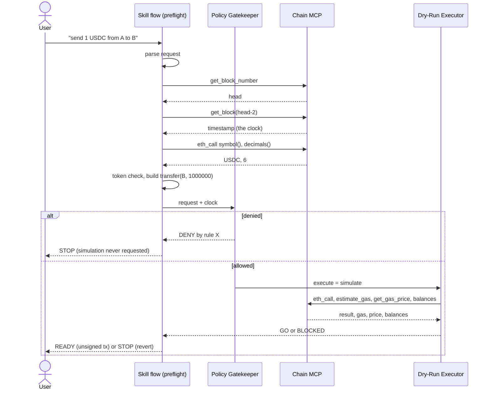

# Transfer Pre-flight Operation Instructions

> Network Configuration: RPC, MCP and chain ID come from `assets/networks.json` (use `mainnet`).
> Private Key: not used. The flow prepares an unsigned transaction.

---

## Run the flow

### Overview

Takes one sentence and a policy and returns a verdict. In order: read the request; ask Chain MCP for the head, then for the pinned block's header (its time is the policy's clock); ask Chain MCP what the token is (`symbol()`, `decimals()`) and refuse a mismatch; build the `transfer` call from those decimals; let the Policy Gatekeeper allow or deny at the block's time; only if allowed, let the Dry-Run Executor ask Chain MCP to simulate (`eth_call`, `estimate_gas`, `get_gas_price`, balances); return READY with an unsigned transaction, or STOP with the rule or the revert.

### Command Template

```bash
node skills/pharos-transfer-preflight/scripts/preflight.mjs --request "send 1 USDC from 0x18573fa18fd17ddfd790b4a5b5b2977aad3b4efb to 0x768b959191ce5876cabbbc014a08d72615bdde54"
```

### Parameters

| Parameter | Type | Required | Description |
|-----------|------|----------|-------------|
| `--request` | text | Yes | `send <amount> <PROS\|USDC\|WPROS> from <0x…> to <0x…>`. A plain decimal amount; two 0x addresses. |
| `--policy` | path | No | Policy JSON (default `examples/policy.json`): spend limit, allowlist and time window rules, see the Policy Gatekeeper. |
| `--block` | integer | No | Pin the whole flow to this block (at most the head minus two). |
| `--out` | path | No | Write the full run (every step and the audit log) as JSON. |
| `--json` | flag | No | Also print the full run. |

### Output Parsing

| Field | Description |
|-------|-------------|
| `SKILL` / `CHAIN MCP` lines | Every step in order. A skill line says what it decided; a Chain MCP line shows the call and the start of the answer. `(uses n, m)` names the earlier steps whose data it used. |
| `READY` | Allowed by the policy and the simulation succeeds. `prepared:` is the unsigned transaction (`to`, `value`, `data`, `gasLimit` with 30% headroom). |
| `STOP: the policy denies it (rule …)` | The named rule decided; the simulation was not requested. |
| `STOP: the policy allows it, but the chain says it would fail` | The decoded revert reason, with the balances read at that block. |
| `STOP: the chain disagrees about which token this is` | Wrong symbol, or the policy counts the token in other decimals than the chain says. |
| `what the chain’s data decided` | Which live facts changed the outcome, with the step that fetched each. |
| Exit code | `0` ready, `10` stop, `1` error. |

### Error Handling

| Error Signature | Cause | Suggested Action |
|----------------|-------|----|
| `could not read the request` | The sentence is not in the supported form | Rephrase: amount, symbol, two addresses. |
| `unknown token` | Only PROS, USDC and WPROS are known | Use one of them. |
| `block must be a whole number from 1 to …` | `--block` is not a past block | Choose an earlier block. |
| `Timed out` / `HTTP 429` / `block is not available` | Chain MCP busy or a node lagging | Retry. |

> **Agent Guidelines**:
> 1. Repeat the request back (amount, token, both addresses) before running it.
> 2. Show the verdict and, for STOP, the named rule or the revert, in the user's words.
> 3. For READY, show the prepared transaction and remind the user that signing is their step and the simulation is a prediction.
> 4. Never retry a STOP by changing the amount to slip under a limit.

---

## Flow diagram

### Overview



The same order as a list: (1) skill parses; (2) Chain MCP head; (3) Chain MCP block header; (4) Chain MCP token facts; (5) skill checks and builds; (6) Policy Gatekeeper decides using step 3's time; (7) only on allow, Dry-Run Executor asks Chain MCP to simulate; (8) skill returns the verdict. The Skills depend on Chain MCP (the clock, the decimals, the balances) and Chain MCP is only asked for the simulation if the Skill allowed it.

### Command Template

```bash
node skills/pharos-transfer-preflight/scripts/preflight.mjs --request "send 1 USDC from 0x18573fa18fd17ddfd790b4a5b5b2977aad3b4efb to 0x768b959191ce5876cabbbc014a08d72615bdde54" --out run.json
```

### Parameters

| Parameter | Type | Required | Description |
|-----------|------|----------|-------------|
| `--out` | path | No | The run as JSON: `steps[]` (number, actor, name, input, output, `uses`), `dependsOn[]`, `log[]`. |

### Output Parsing

| Field | Description |
|-------|-------------|
| `steps[].actor` | `skill` or `chain-mcp`. |
| `steps[].uses` | Numbers of the earlier steps whose data this step consumed. |
| `dependsOn[]` | Live facts that decided the outcome: what, value, the step that fetched it, the effect. |

### Error Handling

| Error Signature | Cause | Suggested Action |
|----------------|-------|----|
| `steps` missing after an error | The flow stopped before recording | The error message names the failing call. |

> **Agent Guidelines**:
> 1. When asked "what called what", answer from `steps`, not from memory.
> 2. Point out the one place the order is conditional: the simulation exists only after an allow.

---

## Repeat a run at a block

### Overview

Because the flow is pinned to one block, a run can be repeated exactly: the block's header, the token facts and the balances read at that block are the same every time. Only the head (`get_block_number`) and the gas price (which has no block parameter) are current. Pinning to an earlier block also lets you see how the chain's clock changes the answer: the same request at a Saturday block is denied by the time window.

### Command Template

```bash
node skills/pharos-transfer-preflight/scripts/preflight.mjs --request "send 1 USDC from 0x18573fa18fd17ddfd790b4a5b5b2977aad3b4efb to 0x768b959191ce5876cabbbc014a08d72615bdde54" --block 20471429
```

### Parameters

| Parameter | Type | Required | Description |
|-----------|------|----------|-------------|
| `--block` | integer | Yes | `20918892` is a Thursday 10:00 UTC block, `20471429` a Saturday 10:00 UTC block (both on Pharos mainnet). |

### Output Parsing

| Field | Description |
|-------|-------------|
| `block … · sat 2026-10-17 10:00:00 UTC` | The block and its time, which is the clock the policy used. |
| `STOP: the policy denies it (rule office-hours)` | The weekend is outside the allowed window. |

### Error Handling

| Error Signature | Cause | Suggested Action |
|----------------|-------|----|
| `block is not available` / a state error | The public node no longer serves state that old | Use a more recent block. |

> **Agent Guidelines**:
> 1. Say plainly that a pinned run is a replay of a past block, not a prediction about now.
> 2. For "what would it do now", run without `--block`.
